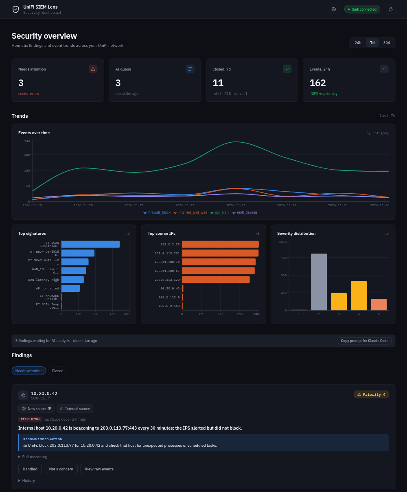

# UniFi Power Tools

One self-hosted service for running an LLM against a UniFi gateway (built
against a UDM Pro). It does three jobs:

- **Syslog ingest.** It listens for the gateway's SIEM (CEF over UDP) export
  and stores IPS/IDS and Security-category events in SQLite: the one thing the
  UniFi Network API doesn't expose.
- **UniFi Network API tools.** Firewall rules and policies, networks, clients,
  traffic rules, port forwards and monitoring, as MCP tools.
- **Triage.** Scheduled heuristics turn events into *findings*, code-driven
  rules close the mechanical ones, and the rest go to a Claude Code session over
  MCP. Every finding ends up either closed, with the reason kept, or on a short
  **Needs attention** list that says what to do in the UniFi console.

Everything is served from one process: a dashboard, a REST API and one `/mcp`
endpoint carrying every tool. The service itself needs no LLM API key.

It replaces three earlier projects, now archived: `unifi-siem-sink`,
`unifi-mcp-server` and `unifi-siem-lens`. Upgrading from those? See
[Migrating from the three services](#migrating-from-the-three-services).



> [!WARNING]
> This is a LAN tool. Never expose it to the internet: run it on your
> network, behind your reverse proxy if you have one, and nowhere else. The
> dashboard has a single password and `/mcp` a single bearer secret; neither
> is meant to face the public.

## Quick Start (Docker)

### 1. Create a `.env` file

Copy [`server/.env.example`](server/.env.example) to `.env` and set at least:

```bash
MCP_SECRET=<a strong random secret>
DASHBOARD_PASSWORD=<a different password>
LAN_CIDRS=10.0.0.0/8,192.168.0.0/16,172.16.0.0/12
# Optional: enables the UniFi tools and client-name enrichment
UNIFI_HOST=<gateway-ip>
UNIFI_API_KEY=<UniFi Network API key>
```

### 2. Run the container

```bash
docker run -d \
  --name unifi-power-tools \
  --env-file .env \
  -p 3002:3002 \
  -p 5514:10514/udp \
  -v unifi-power-tools-data:/data \
  ghcr.io/ianchesal/unifi-power-tools:latest
```

Or `docker compose up -d` with this repo's [`docker-compose.yml`](docker-compose.yml)
(it expects an external `proxy` network for a reverse proxy; remove that if you
don't have one).

### 3. Point the gateway's syslog at it

In UniFi Network, under the SIEM / remote syslog server setting, set the
server to this host and port `5514`.

### 4. Open the dashboard

`http://<homelab-ip>:3002`, and sign in with `DASHBOARD_PASSWORD`.

### 5. Add it to Claude Code

```json
{
  "mcpServers": {
    "unifi-power-tools": {
      "type": "http",
      "url": "http://<homelab-ip>:3002/mcp",
      "headers": { "Authorization": "Bearer <your-MCP_SECRET>" }
    }
  }
}
```

Then, in a Claude Code session with this configured, run
`/mcp__unifi-power-tools__triage`. The command is built from the key you
used under `mcpServers`, so name the entry `unifi-power-tools` (in general it's
`/mcp__<server name>__triage`). Findings the rules couldn't close are queued
automatically; the session loads the triage playbook, fetches the queue,
reasons about each finding with the actual event context, and posts a verdict
(close, or needs attention) back, which then shows up next to the finding. See
[Running triage](#running-triage) for running it on a schedule.

## Known shortcomings

- **Syslog can be lost.** Syslog is UDP and the gateway doesn't retry, so
  events sent while the service restarts (deploys, crashes) are lost. Events
  can also be dropped if an analysis run blocks the process long enough for
  the kernel's UDP receive buffer to fill. The service asks for a 4 MB buffer,
  but Linux caps it at `net.core.rmem_max` (often about 416 KB) unless the
  host raises that. In practice the runs are short: against a real database of
  7,639 events, the hourly checks took 5 to 33 ms and the daily anomaly check
  and recheck 13 to 21 ms. Loss of this second kind isn't counted in
  `/health`'s `droppedMessages`, which counts only oversized messages.
- **UniFi write tools are off by default.** Triage sessions read text an
  attacker can influence (IPS signatures, hostnames, payload fields). With
  write tools on the same `/mcp`, that's the setup for a prompt injection that
  changes your network, so `create_*`, `update_*`, `delete_*`, `block_client`,
  `unblock_client`, `set_client_fixed_ip` and `remove_client_fixed_ip` aren't
  registered at all unless `UNIFI_ALLOW_WRITES=true`. The triage playbook also
  tells sessions never to call them.

## Migrating from the three services

The old `unifi-siem-sink`, `unifi-mcp-server` and `unifi-siem-lens`
containers become one. Your data carries over as is: the sink's `events.db`
and lens's `lens.db` are reused unchanged, in one `/data` volume.

1. **Stop all three old containers** (stopping cleanly checkpoints SQLite's
   WAL into the database files).
2. **Copy both databases into the new volume** and give them to the new
   image's user. Volume names below are the compose defaults; check yours with
   `docker volume ls`.

   ```bash
   UPT_UID=$(docker run --rm ghcr.io/ianchesal/unifi-power-tools id -u uptuser)
   UPT_GID=$(docker run --rm ghcr.io/ianchesal/unifi-power-tools id -g uptuser)
   docker volume create unifi-power-tools_data
   docker run --rm \
     -v unifi-siem-sink_siem-data:/old-sink:ro \
     -v unifi-siem-lens_lens-data:/old-lens:ro \
     -v unifi-power-tools_data:/data \
     alpine sh -c "cp -a /old-sink/events.db* /data/ && cp -a /old-lens/lens.db* /data/ && chown $UPT_UID:$UPT_GID /data /data/*.db*"
   ```

   The `events.db*` and `lens.db*` globs pick up any `-wal`/`-shm` files
   left behind. Chowning `/data` itself matters: SQLite creates its WAL file
   next to the database.
3. **Write the new `.env`** from [`server/.env.example`](server/.env.example).
   Startup fails, naming the replacement, if an old variable is still set:
   `SINK_DB_PATH` and `DB_PATH` became `EVENTS_DB_PATH`, `MCP_PORT`/`MCP_HOST`
   became `PORT`/`HOST`, and `UNIFI_MCP_SERVER_URL`/`_TOKEN` are gone (set
   `UNIFI_HOST` and `UNIFI_API_KEY` instead). `DASHBOARD_PASSWORD` is new and
   required.
4. **Start the new service** (`docker compose up -d`), check
   `http://<host>:3002/health` shows `"status":"ok"`, and check new events
   arrive (the gateway's syslog target stays on port `5514`).
5. **Re-point your reverse proxy** (e.g. Nginx Proxy Manager) at the new
   container, and set `TRUST_PROXY` to the proxy's address if it terminates
   TLS (see [Environment variables](#environment-variables)).
6. **Replace the three MCP entries** in your Claude Code config with the one
   above, named `unifi-power-tools`. The triage command becomes
   `/mcp__unifi-power-tools__triage`.
7. **Remove the old containers** once you're happy.

## How triage works

The rules see every new finding first and close it if every event behind it
has a mechanical explanation. Anything left is queued
for Claude Code, which reads the triage playbook and the finding's real events,
then closes it or sends it to Needs attention. The sections below follow that
order: the lifecycle and its guardrails, the rules, client findings (which
skip the rules), and the playbook that guides the AI step.

### Finding lifecycle

Every finding is in one of three states:

- **`triaging`** — waiting on the pipeline: the rules didn't close it, so an
  analysis request is queued for Claude Code.
- **`attention`** — the AI decided you should do or verify something in the
  UniFi console. The card says what (`recommended_action`) and, for a
  finding that came back, why now (`why_now`).
- **`closed`** — handled, with `closed_by` (`rule`, `ai`, `human`, or
  `system` for findings migrated from the old status set) and a reason.

Each state change is written to the finding's history. A closed finding that
sees new activity is rechecked daily (at most once per 24h): if a rule still
explains everything since the last decision it stays closed, otherwise it
goes back to the AI queue as a recheck, which must explain what changed.
Gaining an `internal_source` trigger sends a rule-closed finding back to
`triaging`. Triggers no longer change status on their own.

Findings from before this model are migrated by lens.db migration 4.

#### Verdict guardrails

`submit_analysis` rejects (leaving the request pending so it can be retried):

- a blank `summary` or `reasoning`;
- an `attention` verdict without `recommended_action` (what to do in the
  UniFi console);
- a recheck without `why_now`;
- a cited playbook entry id that doesn't exist or is retired;
- a `close` while unblocked IPS alerts exist since the last decision, or when
  the events can't be checked (fails closed), unless it cites at least one entry
  you stand behind.

An entry you stand behind is an active one that you wrote or edited, or that
came from a Claude proposal you accepted. Shipped default text alone doesn't
count. Accepting a default's update proposal as proposed makes or leaves the
entry a default, even if you had edited it before; **Edit & accept** with your
own changes, or saving the entry from the Playbook page, makes it yours. The
server checks who stands behind a cited entry, not whether it
covers the traffic: applying entries literally is the playbook's rule. When
every IPS alert was blocked, a `close` needs no citation.

### Rule-based auto-triage

Most findings a live network throws off don't need an LLM at all: your own
console logins, the gateway's WAN-health blips, and routine reputation-list
scans that UniFi already auto-blocked. Rather than queuing every one of
these for a Claude Code session, the service checks each new finding against a
set of rules the moment it's detected, and closes it — with a canned,
code-generated reason, no Claude Code session involved — if every event
behind it is fully explained by one rule:

1. **Trusted admin login** — a console login from an admin name in
   `TRUSTED_ADMIN_NAMES` (see [Environment Variables](#environment-variables) below; empty by default, so this rule never fires unconfigured).
2. **Operational noise** — WAN/device-health telemetry, not a security
   signal.
3. **Low-signal category** — routine `system` / `adminactivity` / `detection` events.
4. **Reputation/blocklist scan** — a blocked hit from a known
   reputation-feed IDS signature family (`SAFE_SIGNATURE_PREFIXES`).
5. **Homelab service egress** — blocked outbound hits on a documented
   homelab service's own port (needs `HOMELAB_SERVICES_PATH`).
6. **Exposed-host scan** — blocked inbound hits on a host marked
   `wanExposed` in the homelab services file.
7. **Ignored signature** — an exact signature excluded from analysis
   (currently the Protect doorbell ring).

A finding with an `internal_source` trigger can only be closed by the
operational-noise rule: an internal host tripping any other rule is the
"possible compromised host" case and always goes to the AI.

A finding that isn't *fully* explained by a rule (mixed events, an
unrecognized signature, an untrusted admin name) is queued for Claude Code
automatically. Client findings never match a rule and are always queued.

Because the rules only run when a finding is created (and on the daily
recheck), findings still `triaging` from before you configured
`TRUSTED_ADMIN_NAMES` (or before you upgraded) never get a rule pass on
their own. Visit **`/admin`** and click **Run backfill** to sweep the
rules over never-decided `triaging` findings, using each finding's original
detection window — safe to run repeatedly; findings the AI already decided
or the operator re-queued are left alone.

### Client findings

Some UniFi Security events (IPS alerts, firewall blocks, honeypot hits)
identify the LAN host only by client name/MAC, with no IP — ingest stores
those with `source_ip` NULL and the host in `source_client_name` /
`source_client_mac`. The service turns each such MAC into a `client` finding (shown
with its latest known client name next to the MAC):

- `new_client` the first time a MAC appears, plus `internal_source` (a
  UniFi-named client is on the LAN by definition), so a new client ranks
  alongside an internal IP finding.
- `repeat_offender` when the client is active on 3+ distinct days in 14,
  counting only those client-only rows.

On the first run after upgrading, every client already in the event history
gets a finding, so past client-only alerts surface once for review. Client
findings are never auto-triaged by the rules above, and are tracked
separately from any IP finding for the same host (IPs change under DHCP;
MACs don't).

### Playbook

The second layer of the triage playbook is **site knowledge**: short, specific
entries about your network, such as which host runs a VPN client or which
blocked scans are expected. They live in `lens.db`, never in this repo. Active
entries are served to Claude with their ids, read fresh each time, so a change
you approve applies from the next run. A verdict that relies on an entry cites
it, and the card shows it under **Relied on**. Name the exact hosts, ports,
signatures or CIDRs: the playbook tells Claude to apply an entry only to what it
names.

#### The Playbook page

`/playbook` has four parts:

- **Pending proposals:** who proposed each one (Claude, or a shipped default
  update), why, and the findings behind it with their history. An edit shows the
  current and proposed text side by side; a retire shows the text being retired.
  **Accept**, **Edit & accept** (not for a retire) or **Reject** with an optional
  note.
- **Active entries:** **Add entry**, **Edit** or **Retire**. Retired entries sit
  in a collapsed group; editing one reactivates it.
- **Change log:** every accepted and rejected proposal, with the id of the entry
  it changed (an add shows none). A retire records the retired entry's own text,
  whatever the proposal said.
- **Homelab registry:** your
  [homelab services file](#homelablocal-service-enrichment), read-only.

Every change to an entry is recorded as a proposal: your own adds, edits and
retirements are saved as proposals accepted on the spot, so the change log is
complete. No MCP tool can apply a change. Applying one goes through the
dashboard's REST API, which has no authentication, so anyone or anything that
can reach the dashboard can approve proposals (see `HOST` under
[Environment Variables](#environment-variables)).

#### Default entries

The service ships five generic entries and adds them at startup:

- blocked inbound scanner fingerprints;
- Git over SSH to GitHub flagged as an outbound SSH scan;
- generic exploit signatures on a VPN client (closes nothing until another entry
  names the host);
- device-status events;
- repeated exploit attempts against a port-forwarded service.

They are yours to edit or retire, and an upgrade never overwrites them. When a
release changes a default's text, it arrives as a pending edit proposal against
your current text, replacing any older update you haven't decided. That includes
a default you retired; accepting the proposal brings it back.

A default you haven't edited is marked **default**, and can't on its own justify
closing traffic that wasn't blocked (see
[Verdict guardrails](#verdict-guardrails)).

#### The learning loop

Your decisions on findings are the input:

- **Handled:** confirms the finding needed action; your note says what you did.
- **Not a concern:** a false alarm; the playbook may be missing something.
- **This was wrong:** a close you reopened, with the reason.

At the end of each triage run Claude reads the decisions it hasn't reviewed,
proposes new entries, edits or retirements where one is warranted, and marks
those decisions reviewed. Nothing changes until you accept a proposal. Rules run
before the AI, so no entry can undo a wrong rule close: if reopening one leads to
a proposal, it should say which rule to consider narrowing in code.

#### Importing existing knowledge

If you already keep triage knowledge in Claude's memory or your own notes, run
`/mcp__unifi-power-tools__import_knowledge` in a Claude Code session that has them
and has the service configured. It checks the current playbook and proposals first,
then sorts what it knows into three groups:

- **Host and port facts that are always benign:** printed as a
  `homelab-services.json` fragment. Check it, merge it into your file
  (`HOMELAB_SERVICES_PATH`) and restart the service.
- **Judgment calls:** one proposal each, for you to approve on the Playbook page.
- **Stale or unverifiable notes:** listed for you, not proposed.

The prompt tells Claude not to write any file itself.

## Running triage

The service has no LLM access of its own. A Claude Code session does the analysis
over MCP, guided by a **triage playbook** the service serves: the run procedure,
when to close and when to send a finding to Needs attention, which UniFi
actions to recommend, and guardrails the playbook can't be talked out of. It
also lists your `TRUSTED_ADMIN_NAMES`, added at request time, so Claude
applies the same trusted-admin rule the rules do. The
playbook's core is code-owned (`server/src/mcp/playbook/`), so it is public and
generic. What is specific to your network is added from the entries you have
approved (see [Playbook](#playbook)). The MCP server's `instructions` point any
client at it. Each run ends by reviewing your recent decisions and proposing
changes to those entries, even when the queue is empty.

**Interactively:** run `/mcp__unifi-power-tools__triage` in a Claude Code
session that has the service configured. The dashboard's queue strip has a button
that copies the command.

**On a schedule:** run it non-interactively from cron on the machine where you
use Claude Code, at most once a day. The run handles up to 25 queued findings
and says so if more remain. For example, every morning at 07:00:

```cron
0 7 * * * cd "$HOME" && "$HOME/.local/bin/claude" -p "/mcp__unifi-power-tools__triage" --allowedTools "mcp__unifi-power-tools" >> "$HOME/upt-triage.log" 2>&1
```

cron runs with a minimal `PATH`, so give `claude` by its absolute path. Use
whatever `command -v claude` prints in your shell; `$HOME/.local/bin/claude`
is the native installer's default.

`--allowedTools "mcp__unifi-power-tools"` pre-approves every tool on this MCP
server and nothing else. That includes proposing playbook changes, which still
wait for your approval, and `list_clients` for client-name lookups when UniFi
is configured. It would also pre-approve the UniFi write tools if you turned
them on with `UNIFI_ALLOW_WRITES=true`; leave that off for scheduled runs.
`claude -p`
picks up the MCP server from your Claude Code config (or pass `--mcp-config`).
It expands the prompt's slash command the same way an interactive session does.
This was checked with Claude Code 2.1.332.

## Homelab/local-service enrichment

An IDS finding pointing at `192.0.2.10:8989` means nothing to a Claude
Code session unless it also knows `192.0.2.10:8989` is your own Sonarr
instance, not a mystery host. `HOMELAB_SERVICES_PATH` points the service at a
local JSON file mapping LAN IPs to the services running on them (typically
the containers on a homelab/NAS box), so that context is attached
automatically whenever a finding involving that IP is queued for analysis.

This is deliberately **not** something you configure by pointing the service at
your Docker Compose files or infrastructure repo directly — the file is a
static, hand-maintained snapshot that lives outside git, so your homelab's
layout never ends up in this (public) repo's history or a published Docker
image.

**Setup:**

1. Copy the template: `cp server/homelab-services.example.json server/data/homelab-services.json`
   (the default `HOMELAB_SERVICES_PATH`; set the env var if you'd rather
   keep it elsewhere).
2. Fill in your own hosts and ports:

   ```json
   {
     "192.0.2.10": {
       "label": "example homelab server",
       "notes": ["Plex remote access is in use on this host"],
       "services": [
         { "port": 8989, "name": "sonarr", "description": "TV show PVR" },
         { "port": 8080, "name": "qbittorrent", "description": "torrent client WebUI" }
       ]
     }
   }
   ```

   Keys are the destination IPs as they appear in `events.db`; `services`
   is matched against each event's `dest_port`. An IP present with no
   matching port still returns the host `label`, so you get partial credit
   ("this is at least *a* known host") even for ports you haven't listed.
   `notes` is optional and free-text — use it for standing, host-wide facts
   that don't map to a single port (e.g. "Plex remote access is in use" or
   "this box is intentionally exposed to the internet via Cloudflare
   Tunnel"). Every note is attached to every event matching that host,
   regardless of which port it hit.
3. Restart the service. The file is loaded once at startup — like `EVENTS_DB_PATH`,
   a missing or malformed file is a silent no-op, never a startup failure.

**What it affects:** the context bundle built when a finding is fetched by a
Claude Code session (`get_analysis_context`) — each recent event in that bundle
gets a `homelab: { host, service }` field the analyzing session sees alongside
the raw event. The `homelab_service_egress` and `exposed_host_scan` auto-triage
rules read it too, and the [Playbook page](#the-playbook-page) shows it
read-only, so anyone who can reach the dashboard can read it. The service loads the
file at startup; restart after editing it.

Put facts a rule can match mechanically (this host and port are benign, this
host is exposed to the WAN) here, and judgment calls in the
[playbook](#playbook).

`server/homelab-services.example.json` (checked in) documents the shape
with placeholder values; `server/data/homelab-services.json` (gitignored,
matching the `data/` pattern used for `lens.db`) is where your real
mapping goes — see [Environment Variables](#environment-variables) below
for `HOMELAB_SERVICES_PATH`.

## Claude Code skill: analyzing findings

If you're working in this repo with Claude Code, `server/.claude/skills/analyzing-findings/`
ships a skill (scoped to the `server` workspace) for running triage from a
development session. It loads the served playbook with `get_playbook` and
follows it, the same as `/mcp__unifi-power-tools__triage`, then adds one
repo-only step: it flags findings that look like candidates for a new
[rule-based auto-triage](#rule-based-auto-triage) rule (a low-risk,
fully-explained pattern that has recurred and isn't already covered by a rule
in `ruleTriage.ts`), without writing the rule code itself. That stays a
deliberate, reviewed change.

Ask a Claude Code session working in this repo to "reanalyze findings", or
invoke it directly as `/server:analyzing-findings`.

## Dashboard & MCP tools

| Surface | What it gives you |
|---|---|
| Dashboard (`/`) | Triage KPI tiles (needs attention, AI queue, closed in 7 days, 24h events), a queue strip (with a button that copies the `/mcp__unifi-power-tools__triage` command), events-over-time / top signatures / top source IPs / severity charts, and two findings views: **Needs attention** (default; each card says what to do in UniFi and why, with the finding's history, and offers Handled / Not a concern; a card with no current AI recommendation, such as one you reopened, also offers Re-analyze) and **Closed** (searchable, filterable by who closed it: rule, AI, human, system; each row has its history and offers **This was wrong** (reopen, with a note) or Re-analyze). A verdict that cited playbook entries shows them as **Relied on**, linked to the Playbook page. The header's **Playbook** link shows how many proposals are pending. |
| Playbook (`/playbook`) | The site knowledge triage relies on: pending proposals, entries, the change log and your homelab registry (see [Playbook](#playbook)). |
| Admin (`/admin`) | One-off maintenance actions — currently just the rule-triage backfill (see [Rule-based auto-triage](#rule-based-auto-triage)). |
| `GET /health` | Liveness, no network calls: `{ status, syslog: { bound, droppedMessages }, eventsDb }`; 503 when degraded (syslog not bound or the events DB failing), so the Docker healthcheck flags it. Open (no sign-in). |
| `GET /ready` | `/health` plus UniFi reachability (`unifi: ok \| unavailable \| not_configured`); 503 only if syslog isn't bound or the events DB fails. Open. |
| `POST /api/auth/login` | Sign in: `{ password }`. Sets the session cookie; 401 for a wrong password, 429 after 10 failed attempts in 15 minutes. |
| `POST /api/auth/logout`, `GET /api/auth/session` | Sign out; check whether the cookie is still valid. |
| `GET /api/findings` | List findings. `view=open\|attention\|triaging\|closed\|all` (default `open`), optional `closed_by`, `q`, and `limit`/`offset` (paginated as `{ items, total }`). Each item carries its latest answered analysis and the note of its latest reopen (`latest_reopen_note`). |
| `GET /api/findings-summary` | Counts for the KPI tiles: `{ attention, triaging, closed_last_7d }`. |
| `GET /api/findings/:id/history` | A finding's audit trail (created, rule/AI/human decisions, rechecks, reopens). |
| `GET /api/findings/:id/activity` | The raw events behind a finding. |
| `POST /api/findings/:id/close` | Operator closes an `attention` finding: `{ kind: "handled" \| "not_concern", note? }`. |
| `POST /api/findings/:id/reopen` | Operator reopens a `closed` finding back to needs attention: `{ note }` (required). |
| `POST /api/findings/:id/reanalyze` | Re-queue a `closed` or `attention` finding for AI analysis. |
| `GET /api/analysis-requests` | Pending requests, or all of a finding's with `?findingId=`. |
| `GET /api/queue` | AI queue stats for the queue strip. |
| `POST /api/admin/backfill-rule-triage` | Re-checks every never-decided `triaging` finding against the auto-triage rules; returns `{ checked, closed, byRule }`. |
| `GET /api/playbook` | `{ entries, registry }`: active entries first, then retired, plus the homelab registry. `is_default` marks an active entry that is still shipped default text; it is also true for every retired entry, so only active ones should be labelled. |
| `GET /api/playbook/proposals` | Proposals, newest first (`status=pending\|accepted\|rejected`, optional), each with the findings cited as evidence (`missing_evidence_count` counts cited findings that no longer exist) and the entry it would change. |
| `POST /api/playbook/proposals` | Add an entry yourself: `{ title, body }`. |
| `POST /api/playbook/proposals/:id/accept` | Apply a pending proposal, optionally with your own text: `{ edited_title?, edited_body? }`. |
| `POST /api/playbook/proposals/:id/reject` | Reject a pending proposal: `{ note? }`. |
| `PUT /api/playbook/entries/:id` | Edit an entry (reactivates a retired one): `{ title, body }`. |
| `POST /api/playbook/entries/:id/retire` | Retire an entry: `{ note? }`. |
| `triage` (MCP prompt) | The triage playbook plus run procedure. In Claude Code: `/mcp__unifi-power-tools__triage`. |
| `get_playbook` (MCP) | The same playbook as a tool result, for clients that can't use MCP prompts. |
| `import_knowledge` (MCP prompt) | Moves triage knowledge from a session's notes into proposals and a registry fragment. In Claude Code: `/mcp__unifi-power-tools__import_knowledge`. |
| `get_pending_analyses` (MCP) | List queued analysis requests, highest severity first (`limit?`). |
| `get_analysis_context` (MCP) | Full context for one request, built when you fetch it: the finding, its history, prior analyses, recent events, activity since the last decision, and (for rechecks) before/after activity summaries. |
| `submit_analysis` (MCP) | Post a verdict (`close` or `attention`) with risk level, summary, reasoning and the ids of any playbook entries it relies on (`cited_entries`); see [Verdict guardrails](#verdict-guardrails). |
| `get_feedback` (MCP) | Your Handled / Not a concern / This was wrong decisions that no run has reviewed yet, oldest first (`limit?`, 1–100, default 50). A reopen also says what it undid. |
| `mark_feedback_considered` (MCP) | Mark those rows reviewed: `{ ids }`. |
| `propose_playbook_change` (MCP) | Propose adding, editing or retiring an entry: `op`, `entry_id?`, `title`, `body`, `rationale`, `evidence`. It stays pending until you decide. |
| `list_playbook_proposals` (MCP) | List proposals (`status?`), so a run doesn't repeat a pending or rejected one. |
| `list_events`, `get_event`, `get_categories`, `get_event_stats` (MCP) | Query the stored syslog events directly: filter by time, category, IP, signature; one event in full; the categories seen; counts by category/severity/action. |
| UniFi read tools (MCP) | `list_*` / `get_*` for firewall rules, groups, zones and policies, networks, clients (`list_clients`, `get_client`), traffic rules, port forwards, site stats, device health, network events and rogue APs. Present only when `UNIFI_HOST` and `UNIFI_API_KEY` are set. |
| UniFi write tools (MCP) | `create_*` / `update_*` / `delete_*` for the above, `block_client`, `unblock_client`, `set_client_fixed_ip`, `remove_client_fixed_ip`. Registered only with `UNIFI_ALLOW_WRITES=true`; annotated `destructiveHint`. |

Everything under `/api` except `/api/auth/*` needs the session cookie, and
every `POST`/`PUT` there must send `Content-Type: application/json` (a body of
`{}` is fine), so a cross-site form can't trigger one. `/mcp` takes only the
`MCP_SECRET` bearer, never the cookie.

## Environment Variables

| Variable | Required | Default | Description |
|---|---|---|---|
| `MCP_SECRET` | yes | — | Bearer token clients must send as `Authorization: Bearer <MCP_SECRET>` to call `/mcp` |
| `DASHBOARD_PASSWORD` | yes | — | Password for the dashboard and REST API. Must differ from `MCP_SECRET`. Changing it signs everyone out |
| `PORT` | no | `3002` | HTTP port: dashboard, `/api`, `/mcp`, `/health`, `/ready` |
| `HOST` | no | `127.0.0.1` (`0.0.0.0` in Docker) | Bind address. Widen it deliberately, and never to an internet-facing interface |
| `TRUST_PROXY` | no | *(unset)* | Your reverse proxy's address, subnet or hop count, passed to Express `trust proxy`. Set it when the proxy terminates TLS so the session cookie is marked `Secure` and the login rate limit sees real client IPs. Never `true` (rejected at startup): port 3002 is reachable directly too, so trusting everyone would let a client forge its IP |
| `EVENTS_DB_PATH` | no | `./data/events.db` (`/data/events.db` in Docker) | The syslog event store |
| `LENS_DB_PATH` | no | `./data/lens.db` (`/data/lens.db` in Docker) | Findings, baselines, seen-entity tracking, the analysis-request queue, playbook entries and proposals |
| `SYSLOG_UDP_PORT` | no | `10514` | UDP port for the gateway's CEF syslog |
| `SYSLOG_BIND_ADDRESS` | no | `0.0.0.0` | Bind address for syslog |
| `MAX_MESSAGE_BYTES` | no | `16384` | Larger datagrams are dropped and counted in `/health` |
| `RETENTION_DAYS` | no | `90` | Events older than this are purged hourly |
| `UNIFI_HOST`, `UNIFI_API_KEY` | no | *(unset)* | UniFi gateway IP or hostname (a leading `https://` is stripped) and API key. Set both or neither (one alone fails startup). Both set: UniFi read tools on `/mcp`, client-name and firewall-summary enrichment of analysis context, and `/ready` checks the controller |
| `UNIFI_SITE` | no | `default` | UniFi site |
| `UNIFI_VERIFY_TLS` | no | `false` | Verify the controller's TLS certificate (`true` to enable) |
| `UNIFI_REQUEST_TIMEOUT_MS` | no | `10000` | Per-request timeout for UniFi API calls |
| `UNIFI_ALLOW_WRITES` | no | `false` | Only the literal `true` registers the UniFi write tools on `/mcp`. See [Known shortcomings](#known-shortcomings) |
| `LAN_CIDRS` | no | *(none)* | Comma-separated CIDRs treated as internal/LAN for the internal-source heuristic, e.g. `10.0.0.0/8,192.168.0.0/16` |
| `TRUSTED_ADMIN_NAMES` | no | *(none)* | Comma-separated admin display names (as they appear in UniFi's own audit log, e.g. `Ian C.`) that auto-dismiss `new_source_ip` findings which are entirely explained by that admin logging into the UniFi console. Empty by default — this rule never fires until configured |
| `SAFE_SIGNATURE_PREFIXES` | no | `ET DROP,ET CINS,ET TOR,ET COMPROMISED,ET DSHIELD` | Comma-separated IDS/IPS signature prefixes (Emerging Threats' reputation/blocklist rule-family naming convention) that auto-dismiss a finding when every backing event is a blocked hit from one of these signature families. Prefixes are matched via SQL `LIKE` (case-insensitive; a configured prefix containing `%` or `_` acts as a wildcard) — keep entries specific |
| `HOMELAB_SERVICES_PATH` | no | `./data/homelab-services.json` | Path to a local, never-committed JSON file mapping LAN host IPs to the services running on them (e.g. a homelab server's Docker containers — see `server/homelab-services.example.json` for the shape). Analysis context labels event destinations that match an entry (e.g. `192.0.2.10:8989` → `sonarr`) instead of leaving them as bare IP:port. Missing file is a no-op — this enrichment is entirely optional |
| `LOG_LEVEL` | no | `info` | `error` \| `warn` \| `info` \| `debug` |

Removed in 2.0.0, and rejected at startup with the replacement named:
`SINK_DB_PATH`, `DB_PATH` (use `EVENTS_DB_PATH`), `MCP_PORT`, `MCP_HOST` (use
`PORT`, `HOST`), `UNIFI_MCP_SERVER_URL`, `UNIFI_MCP_SERVER_TOKEN` (UniFi is
built in: set `UNIFI_HOST` and `UNIFI_API_KEY`).

---

## Development (Running from a Repo Clone)

### Setup

```bash
git clone https://github.com/ianchesal/unifi-power-tools
cd unifi-power-tools
npm install
cp server/.env.example server/.env
# edit server/.env: set MCP_SECRET and DASHBOARD_PASSWORD (and UNIFI_* if you want the UniFi tools)
```

### Run with Docker Compose

```bash
docker compose up -d --build
```

Reads `.env` from the repo root (copy `server/.env.example`). Exposes
`3002/tcp` (dashboard, API, MCP) and `5514/udp` (syslog, to the container's
`10514`). Both databases persist in the `data` named volume.

### Run locally

```bash
npm run dev
```

Starts the server (`http://localhost:3002`) and the Vite dev server
(`http://localhost:5173`, proxying `/api` to the server) together. The
server's `/mcp` endpoint is served directly on port 3002 and is not
proxied through Vite.

> **Note:** If `npm run dev -w server` fails to boot (a known issue on
> Node 24.x/25.x: `--experimental-strip-types` doesn't resolve `.js`-suffixed
> relative imports against sibling `.ts` files), use
> `npm run build -w server && npm run start -w server` instead, alongside
> `npm run dev -w web` for the frontend.

### Production build

```bash
npm run build
npm start
```

Builds both packages and serves the built dashboard + API + MCP endpoint
from a single process on `PORT` (default `3002`).

### Tests

```bash
npm test          # server test suite (vitest)
npm run lint       # biome (server) + oxlint (web)
```

## Cutting a release

Releases are tag-driven. Pushing a `v*` tag to GitHub triggers
`.github/workflows/release.yml`, which:
- Builds and pushes a Docker image to `ghcr.io/ianchesal/unifi-power-tools`
  (tagged `latest`, `{major}.{minor}`, and `{version}`)
- Creates a GitHub Release with auto-generated notes

**Steps to release:**

1. Ensure all changes are merged to `main` and CI is green.
2. Decide the new version (follows semver: `MAJOR.MINOR.PATCH`).
3. Update `"version"` by hand in `package.json`, `server/package.json`,
   `web/package.json` and the matching entries in `package-lock.json` (never
   `npm version`: it strips the lockfile's libc fields).
4. Commit: `git commit -m "chore: release v{version}" package.json server/package.json web/package.json package-lock.json`
5. Tag: `git tag v{version}`
6. Push both: `git push origin main && git push origin v{version}`

The release workflow fires automatically on the tag push. No manual Docker
build or GitHub Release creation needed.

## License

[MIT](LICENSE)
